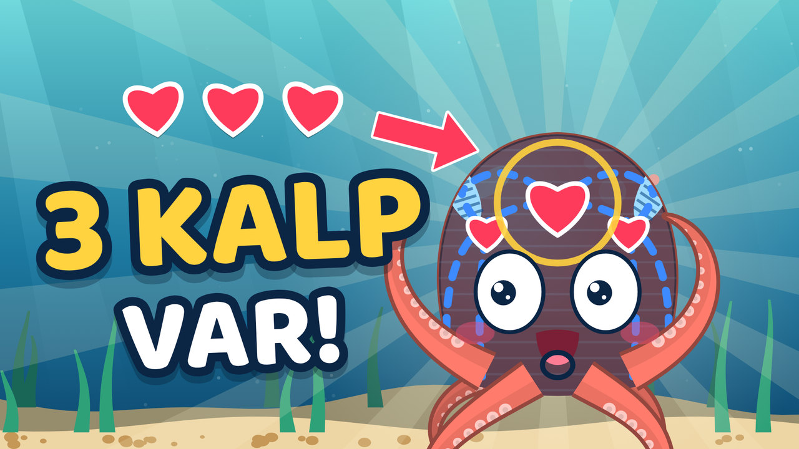

# Oki Engine — a kids' cartoon rendered entirely from code

**Oki — The Octopus** is a 3-minute Turkish kids' episode in which Oki explains the octopus in seven surprising facts. No AI video model, stock footage or audio sample is used: every frame is drawn with Canvas 2D, rendered frame by frame in headless Chromium and encoded with ffmpeg. Music and sound effects are synthesised in Python.

Made by [TEMİZ STUDIO](https://tmzstudios.com) with Claude Code. Watch a silent excerpt in the [Lab section](https://tmzstudios.com/#lab).



## Pipeline

```
bolum.js (timing, voice-over, facts, music)  →  scenes/sXX_*.js  →  preview + contact sheet
→  checks (dogrula.py, tara.mjs)  →  render.mjs (4 Chromium tabs → JPEG → x264)
→  audio.py (marimba/bass/drums + 18 SFX, VO ducking)  →  srt.py  →  ffmpeg final mix
```

- **Deterministic:** no `Math.random`; seeded RNG means the same second always draws the same frame.
- **Scene contract:** every scene is a pure `draw(t)` with its own prefix — see `docs/SAHNE_BRIFI.md`.
- **Checked before render:** the whole 180 s is scanned at 10 fps for console errors and empty frames.
- **Character sheet:** `karakter.html` shows all of Oki's poses on one page.

## Run it

```bash
npm install && npx playwright install chromium
pip install numpy pillow imageio-ffmpeg
node tools/preview.mjs      # stills for the contact sheet
node tools/render.mjs       # out/video_sessiz.mp4 + out/cues.json
python tools/audio.py       # out/muzik_sfx.wav
python tools/srt.py         # subtitles
```

Docs are in Turkish: `docs/NASIL_CALISIR.md` (how it works), `docs/STORYBOARD.md`, `YAYIN_PAKETI.md` (timed script and publishing pack).

## How it was built

The main Claude Code session wrote the engine, the character and the framing scenes; two sub-agents wrote the middle scenes against the scene contract. The human side: concept, art direction, review of every scene. The next step is turning the scene contract into reusable agent skills for further episodes.

## License

- Code: MIT (see `LICENSE`).
- Oki character, story and episode content: © 2026 TEMİZ STUDIO, all rights reserved.
- Font: Baloo 2, SIL Open Font License (`fonts/OFL.txt`).
